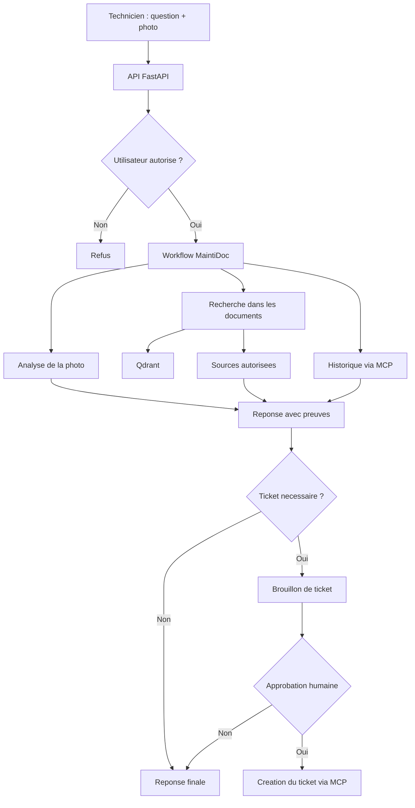
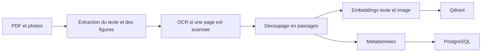
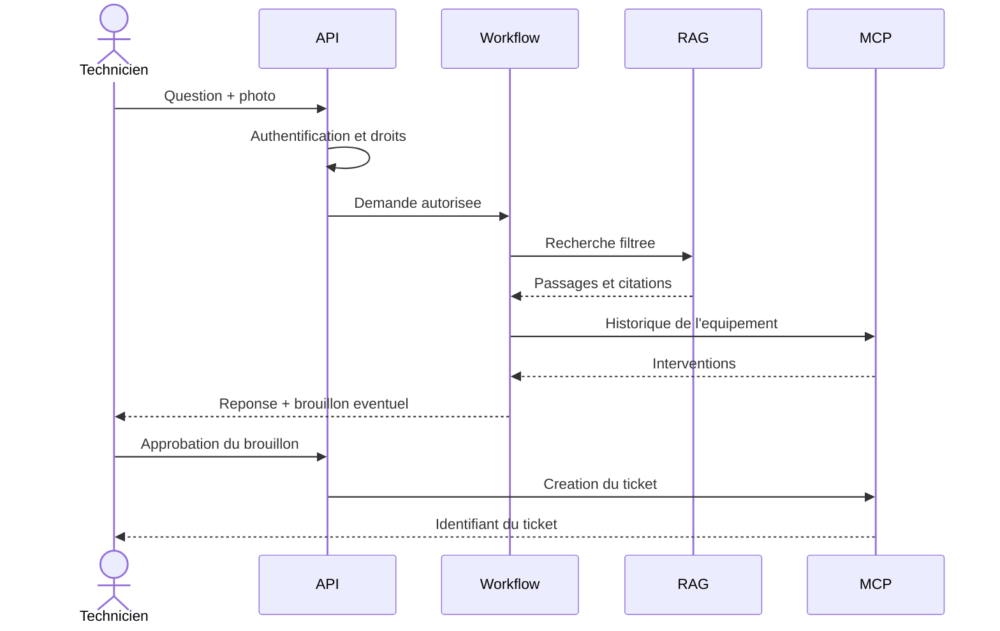

# 02 - Architecture MaintiDoc

## 1. L'idee en une phrase

MaintiDoc recoit une question et, si besoin, une photo. Il cherche les
informations autorisees dans les documents, les compare avec l'historique de
maintenance, puis produit une reponse citee. Il ne cree jamais un ticket sans
approbation humaine.

## 2. Les composants principaux

| Composant | Role |
|---|---|
| Interface Streamlit | L'utilisateur pose une question et ajoute une photo |
| API FastAPI | Authentifie l'utilisateur et controle ses droits |
| Workflow LangGraph | Coordonne les etapes dans le bon ordre |
| RAG | Recherche les passages pertinents dans les documents |
| Modele vision-langage (VLM) | Analyse les photos et formule la reponse |
| Serveur MCP | Fournit l'historique et gere les tickets |
| Qdrant | Recherche vectorielle des textes et des images |
| PostgreSQL | Stocke les metadonnees |
| MinIO | Stocke les PDF, pages et figures |
| MLflow | Conserve les traces des experimentations |

## 3. Vue simple du fonctionnement



### Explication du parcours

1. Le technicien envoie une question et éventuellement une photo.
2. FastAPI identifie l'utilisateur et ses groupes d'accès.
3. Le workflow analyse la photo pour reconnaitre l'équipement.
4. Le RAG recherche uniquement dans les documents accessibles à cet utilisateur.
5. Le workflow consulte l'historique de maintenance si la question le demande.
6. Le modèle rédige une réponse avec les sources réellement utilisées.
7. Si une action est utile, un brouillon de ticket est proposé.
8. Le ticket est créé uniquement après approbation explicite.

## 4. Le RAG, étape par étape

Le RAG signifie « Retrieval-Augmented Generation » : le modèle ne répond pas
seulement avec sa mémoire, il consulte d'abord les documents du projet.

### 4.1 Préparation des documents (hors ligne)



Chaque passage conserve notamment :

- l'identifiant et la version du document ;
- la page et le type d'élément (texte, tableau ou figure) ;
- la famille d'équipement ;
- les groupes autorisés ;
- le statut actif ou remplacé ;
- la zone de la figure (`bbox`) si nécessaire.

### 4.2 Recherche pendant une question

1. Le système filtre Qdrant avec les groupes de l'utilisateur.
2. Il recherche dans le texte et, si une photo est fournie, dans les images.
3. Il fusionne les résultats texte et image.
4. Le reranker classe les passages les plus utiles.
5. Seuls ces passages sont transmis au modèle.
6. La réponse cite les pages et figures récupérées.

Le contenu d'un document est toujours traité comme une donnée, jamais comme
une instruction. Cela limite les risques d'injection dans les documents.

## 5. Sécurité et droits

Le contrôle d'accès est effectué à trois moments :

1. avant la recherche, avec un filtre Qdrant ;
2. lors de l'ouverture d'un document ou d'une image ;
3. dans le serveur MCP avant chaque appel.

Pour créer un ticket, le serveur vérifie :

- l'identité de l'utilisateur ;
- son droit sur l'équipement ;
- un jeton d'approbation signé ;
- que le contenu approuvé est exactement celui envoyé ;
- une clé d'idempotence pour éviter les doublons.

## 6. Exemple de scénario nominal



## 7. Limites et budgets

- maximum 3 appels MCP par demande ;
- maximum 6 appels au modèle ;
- maximum 60 secondes de traitement automatique ;
- image limitée à 8 Mpx ;
- réponse limitée à 1 024 tokens ;
- aucune commande envoyée à un équipement ;
- aucune création de ticket sans validation humaine.

## 8. Organisation du code prévue

```text
maintidoc/
├── corpus/                 # génération des PDF, photos et manifeste
├── data/fixtures/          # utilisateurs, équipements et interventions fictifs
├── prompts/                # prompts versionnés
├── src/maintidoc/
│   ├── corpus/             # schéma et validation du manifeste
│   ├── ingestion/          # extraction PDF, figures et OCR
│   ├── retrieval/          # embeddings, Qdrant et recherche hybride
│   ├── vlm/                # analyse image et génération de réponse
│   ├── agent/              # workflow et budgets
│   ├── mcp_server/         # historique et tickets
│   └── api/                # API et contrôles d'accès
├── tests/
├── docker-compose.yml
└── .env.example
```

## 9. Choix techniques

| Besoin | Technologie prévue |
|---|---|
| API | FastAPI |
| Interface | Streamlit |
| Workflow | LangGraph |
| Embeddings texte | BAAI/bge-m3 |
| Recherche vectorielle | Qdrant |
| Extraction PDF | PyMuPDF |
| OCR | Tesseract en français |
| Modele vision-langage | Qwen2.5-VL-7B-Instruct |
| Metadonnees | PostgreSQL |
| Fichiers | MinIO |
| Suivi | MLflow |

Les versions exactes des dépendances et des modèles seront figées avant
l'implémentation. PyMuPDF et MinIO devront également être vérifiés au regard
de leur licence avant une éventuelle distribution du projet.
